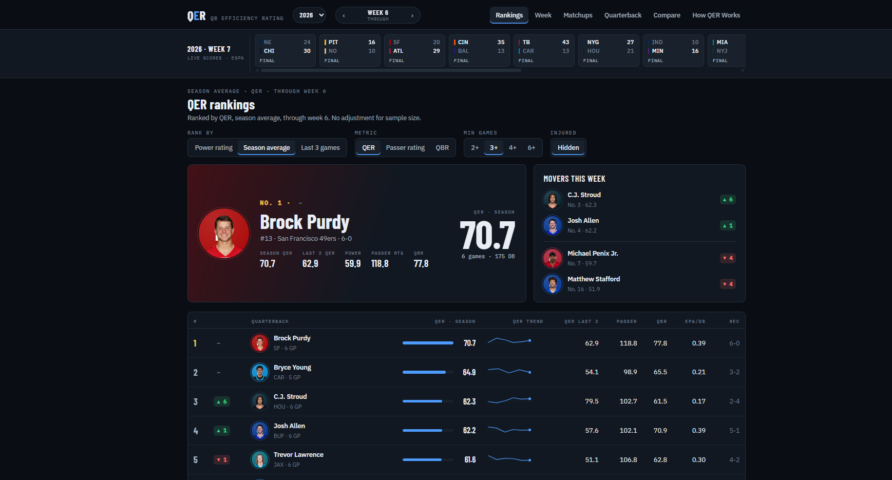
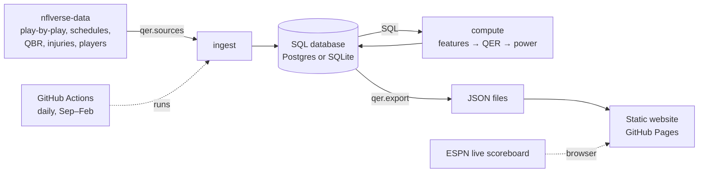

# QER: QB Efficiency Rating

An original NFL quarterback metric, plus the full system around it: an automated data
pipeline, a SQL database, a validation suite, and a live website that updates itself
every morning of the season.

**Live site:** https://ahampto.github.io/QER-dashboard/



## What it does

- **Grades every QB start since 2006** (13,000+ games) on a 0–100 scale, from play-by-play.
- **Ranks QBs every week**, by QER Power rating (a sample-size-aware season rating) or by
  season QER, last-3 QER, passer rating or ESPN QBR.
- **Compares any two QBs** on QER, passer rating or QBR, filtered by opponent, seasons or
  playoffs, with their head-to-head games. Example: Brady vs Peyton, only against Baltimore.
- **Shows each QB's page:** game log, what built each grade, career by season, injury status.
- **Matchups** for any week, with each QB's rating going into the game.
- **Live scores** during games from ESPN's public scoreboard. Click a game in progress for a
  live QER estimate (a box-score model, typically within 7 points of the final QER, which
  posts the next morning once play-by-play EPA and CPOE are available).

## How it works



| Step | Code | What happens |
|---|---|---|
| Ingest | `qer/sources.py`, `qer/pipeline.py` | Download nflverse data; store raw plays, schedules, QBR, injuries, players in SQL |
| Compute | `qer/features.py`, `qer/formula.py`, `qer/power.py` | Read plays *from the database*, build per-game inputs, score QER, build weekly power ratings |
| Store | `qer/db.py` | Idempotent replace-by-season writes; schema evolves automatically; old raw plays prunable |
| Export | `qer/export.py` | Write compact JSON for the site (column-wise arrays, ~300 KB per season) |
| Display | `site/` | Plain HTML/CSS/JS, no framework or build step; hosted free on GitHub Pages |
| Automate | `.github/workflows/` | Daily update + deploy; tests and lint on every push |

### Database tables

| Table | One row per | Notes |
|---|---|---|
| `plays` | play | 46 columns of play-by-play (raw input) |
| `games` | game | Schedule, scores, betting lines |
| `qbr_weekly` | QB-game | ESPN Total QBR |
| `injuries` | player-week | Official injury reports (2009+) |
| `players`, `teams` | QB / team | Photos, bios, colors |
| `qb_games` | QB-game | Box score, QER inputs, components, QER, passer rating, QBR |
| `qb_drives` | QB × scoring drive | Drive credit behind component C |
| `power_ratings` | QB × week | Season-to-date rating, rank, movement |
| `pipeline_runs` | run | Audit log |

## QER v2.5

| Component | Points | Rewards | Built from |
|---|---|---|---|
| A · Accuracy | 20 | Completing harder throws than expected | CPOE |
| B · Efficiency | 30 | Yards the QB created per dropback | EPY/DB: air yards + half the YAC on throws of 13+ air yards |
| C · Scoring | 30 | His share of each TD and FG drive | YAC-filtered pass EPA + 0.65 × positive rush EPA, over drive EPA |
| D · Security | 20 | Avoiding turnovers and sacks | EPA lost to INTs, sacks and fumbles per dropback |

A win adds +1 to +5, more for better games. Capped at 100.

**Design decisions, each backed by a test on 2006–2025 data:**
- **Scale calibrated on all 11,048 starts** (not a hand-picked sample): B scores zero only
  in the worst 5% of games, D in the worst 3%; ceilings sit at the top 0.1% so no single
  fluke game sets the scale.
- **Fumbles:** recovery is mostly luck (QBs lose 42%), so every QB fumble costs a
  league-average expected cost and a lost one adds half its actual cost. D became 8% more
  consistent. Bad snaps charged to the center never count against the QB.
- **Sacks** count against the QB who took them, not the starter.
- **Intentional grounding** counts once (it is already an attempt in the data).

**Validation:** the code reproduces all 140 games of the original v2.2 spreadsheet model
exactly (`QERParams.v2_2()`), and each later version is kept as a preset so any game can be
compared across versions.

| Across 2006–2025 starts | QER | ESPN QBR | Passer rating |
|---|---|---|---|
| Average start | 48 | 54 | 56 (÷158.3) |
| Week-to-week consistency | 0.46 | 0.52 | 0.49 |
| Predicts later efficiency (EPA/dropback) | 0.47 | 0.45 | 0.46 |
| Drifts upward over the years | No | No | Yes (84 → 91) |

### Power rating

Each QB starts the season at his own 2025 level (pulled toward that year's league average
in proportion to how little he played; rookies start at league average) and moves toward
his current-season QER as he piles up dropbacks. Recent games count slightly more (5% less
per week back). Backtested against alternatives on 2006–2025: it predicts rest-of-season
QER about 4% better than starting everyone at league average, and 5% better in Weeks 1–4.

## Run it yourself

```bash
python -m venv .venv && source .venv/bin/activate      # Windows: .venv\Scripts\activate
pip install -r requirements-dev.txt
python -m qer.pipeline run --season 2025-2026           # about 15 seconds, writes data/qer.db
python -m qer.export                                    # writes site/data/
python -m http.server 8000 -d site                      # open http://localhost:8000
pytest -q                                               # 36 tests
```

`python -m qer.pipeline run --season 2006-2026` backfills everything (about 3 minutes).

## Deployment

GitHub Actions runs the pipeline every morning of the season and publishes `site/` to
GitHub Pages. With no database configured it rebuilds every season into a temporary
SQLite file (about 5 minutes). With a hosted Postgres URL in the `DATABASE_URL` secret,
each run refreshes only the current season and keeps every season's results.

## Repository layout

```
qer/            pipeline, metric and export (Python)
  params.py     every tunable number, with version presets v2.2–v2.5
  formula.py    QER components and passer rating
  features.py   play-by-play → per-game QER inputs
  power.py      weekly power ratings
  pipeline.py   ingest + compute CLI
  export.py     database → website JSON
  live_model.py live QER estimate from the in-game box score
  db.py         database access (Postgres or SQLite)
  sources.py    nflverse downloads
site/           the website (index.html, styles.css, app.js)
tests/          36 tests, including exact reproduction of the original spreadsheet
docs/ROADMAP.md open work and formula changes under evaluation
```

## Roadmap

Next up: recalibrating component A (CPOE), which saturates on about a quarter of games;
clutch robustness in the win bonus; an EPA-based live estimate; estimated QER for
1999–2005; and an opponent-adjusted model. Details in [docs/ROADMAP.md](docs/ROADMAP.md).

## Data

Play-by-play, schedules, rosters, injuries and QBR from
[nflverse](https://github.com/nflverse/nflverse-data) (CC-BY 4.0). EPA, CPOE and win
probability are nflverse model outputs. Live scores from ESPN's public scoreboard.
